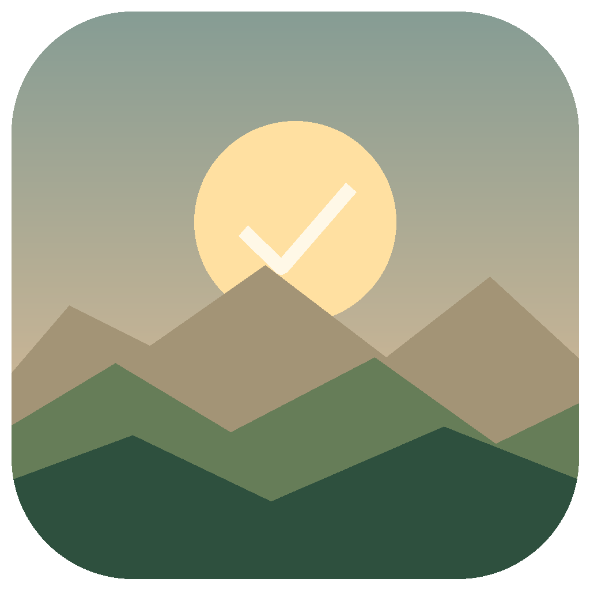
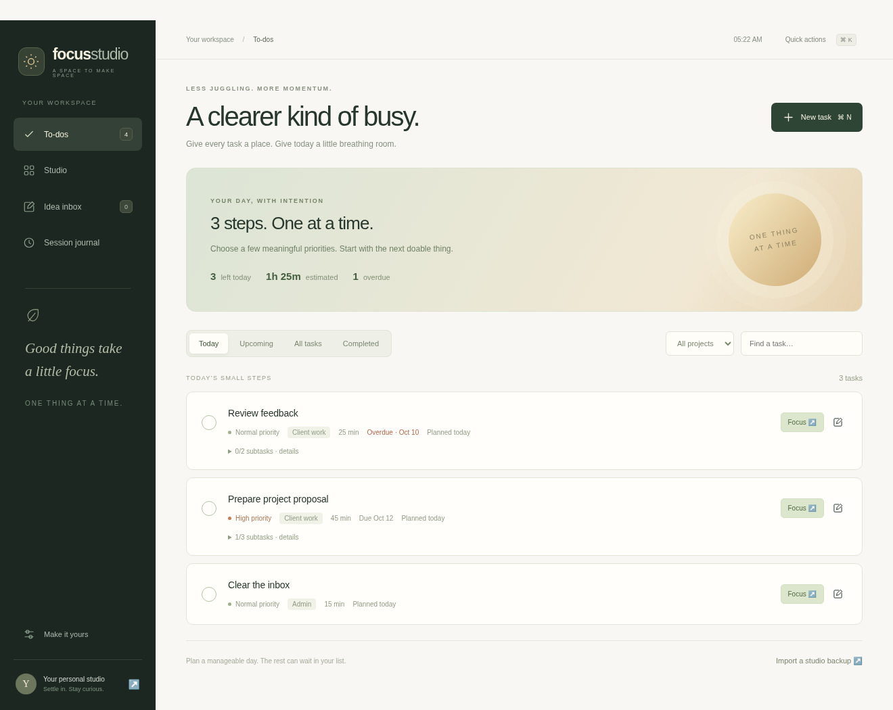
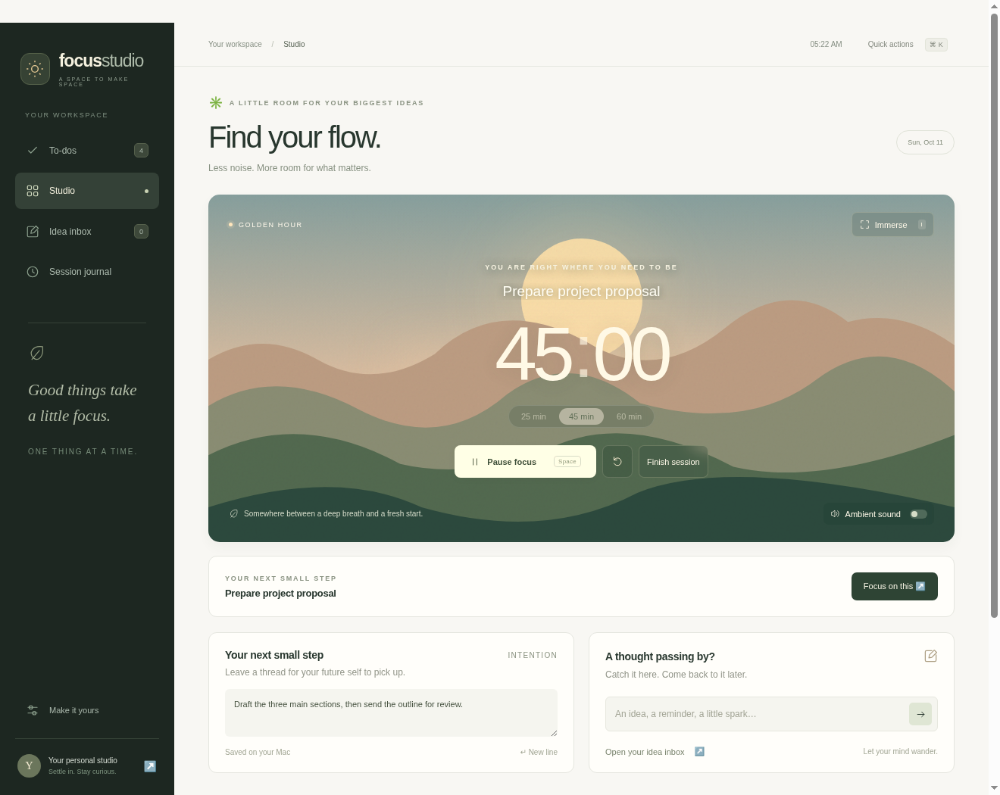
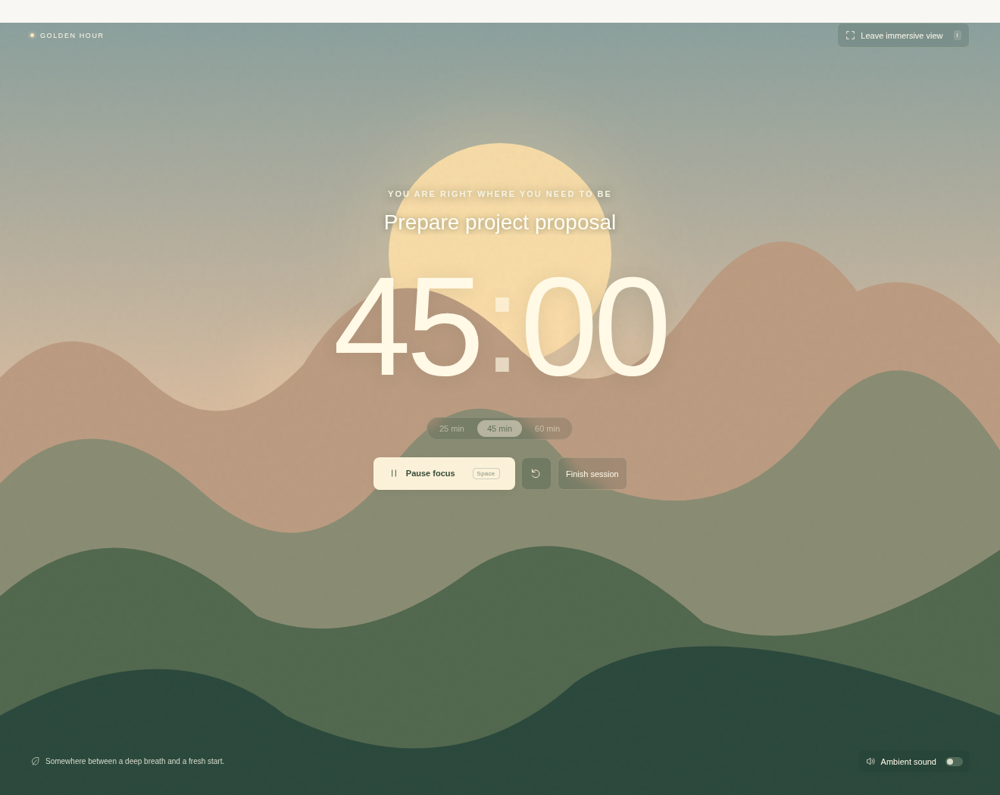

<p align="center">
  
</p>

# Focus Studio for macOS

A standalone, offline desktop workspace for a busy day: tasks, projects, priorities, due dates, subtasks, and immersive focus sessions.

Version 0.2.1 targets Apple silicon (M-series) Macs running macOS 13 or newer. The desktop app uses Electron with native macOS menus, Dock integration, a menu-bar timer, file dialogs, and completion notifications. It bundles its interface locally.

## Preview



| Focus on one task | Step into immersive view |
| --- | --- |
|  |  |

These are actual desktop UI captures with sample work, taken in Electron on Linux. Mac system controls still need device validation. See the [full screenshot gallery](docs/preview.md) and [illustrated how-to guide](docs/user-guide.md).

## Get started

This repository contains source code and documentation. On your Apple silicon Mac, install Node 24 or later, then run:

```sh
git clone https://github.com/samidun26/sumthink.git
cd sumthink/desktop
npm ci
npm run install:mac
```

If you already cloned the repo, run `git pull --ff-only` inside it before installing. The installer rebuilds and verifies the bundle, installs it to ~/Applications/Focus Studio.app, retains the previous app as a .backup directory, and requests launch. Tasks, journal, and settings are preserved. Once the app opens, you can close Terminal; no npm start is needed.

Local Mac builds use an ad-hoc development signature with hardened runtime explicitly disabled. They have no Developer ID signature or notarization. See [the Mac installation guide](docs/macos-app.md) for installation details and troubleshooting.

Add work with Command N, plan a manageable Today list, and use Focus on a task. Follow the [illustrated guide](docs/user-guide.md).

## Useful workflows

- Today, Upcoming, All tasks, and Completed.
- Project filters, search across notes/subtasks, priority, due dates, planned dates, and effort estimates.
- A daily workload summary with overdue work and a suggested next task.
- Task-to-focus linking, reflections, and an optional complete-task step.
- Illustrated scenes, immersive view, gentler motion, and opt-in rain.
- A menu-bar countdown, native shortcuts, Dock badge, and focus completion notification.
- Local JSON persistence, a previous-state backup, and native import/export. Existing web exports can be imported.

## Develop on your Mac

Requires Node 24 or later. Dependencies are pinned in desktop/package-lock.json.

```sh
cd desktop
npm ci
npm start
```

Build an Apple silicon app bundle:

```sh
npm run package:mac
```

Packaging on a Mac applies an ad-hoc development signature with hardened runtime disabled for local use; this is not Developer ID signing or notarization. The process also creates a ZIP under desktop/release/. Developer ID distribution remains a separate release step.

## Verify

```sh
cd desktop
npm test
npm run test:desktop
```

The real desktop test requires a graphical session. It was run on Linux with Xvfb and a Linux Electron runtime; it does not verify macOS-specific menu bar, Dock, notifications, Gatekeeper, or VoiceOver behavior.

See [documentation](docs/README.md), [the macOS guide](docs/macos-app.md), and [validation](docs/validation.md).

## Refresh documentation screenshots

After installing desktop dependencies, run `npm run capture:previews` from desktop/ in a graphical session. It captures the app using an isolated temporary profile and removes the sample data afterward. Linux environments need a display, for example `DISPLAY=:99 npm run capture:previews` with Xvfb running. See [capture notes](docs/preview.md#refresh-the-captures).

## Earlier web prototype

The original browser source remains under dist/. The desktop app has its own renderer under desktop/renderer/. The native app stores data in its own local file; it does not automatically read browser storage. Export from the web journal and import into the desktop app to transfer your data.
