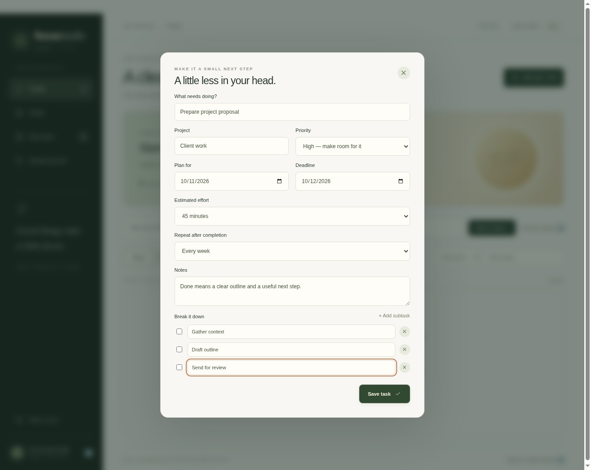
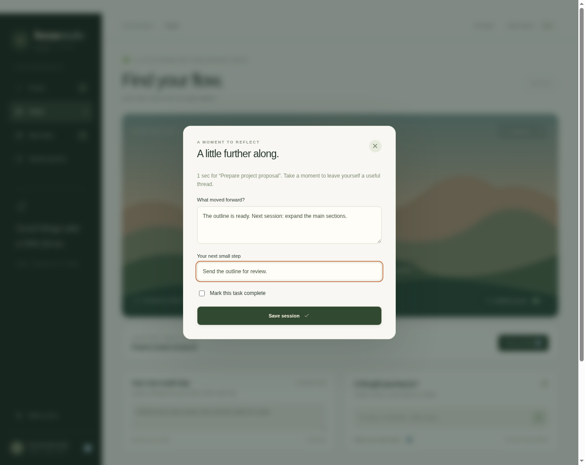
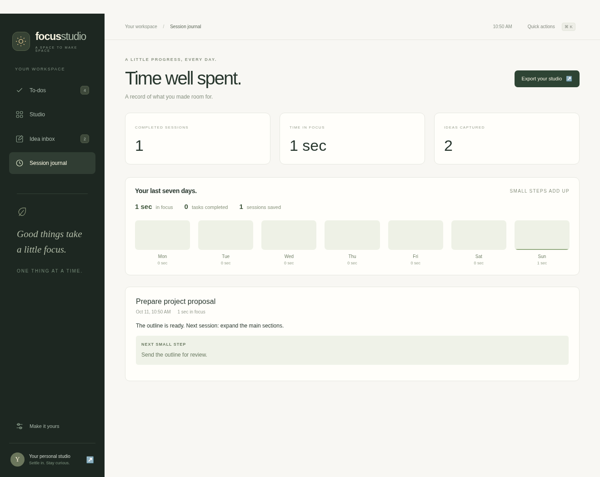
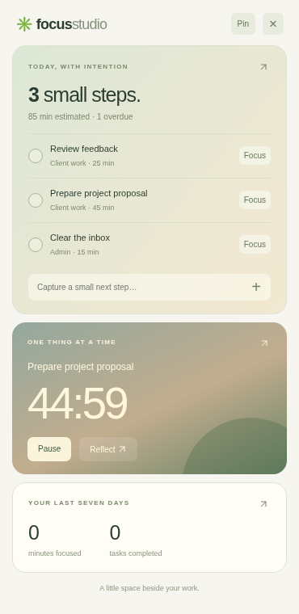
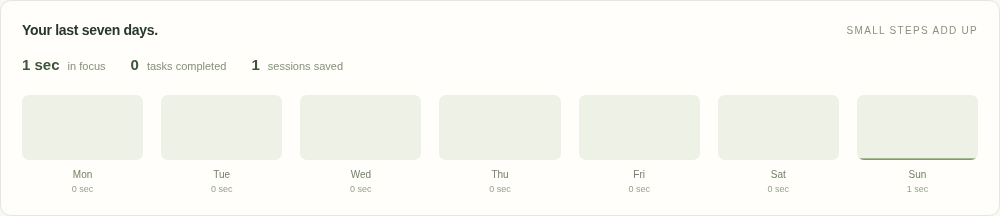
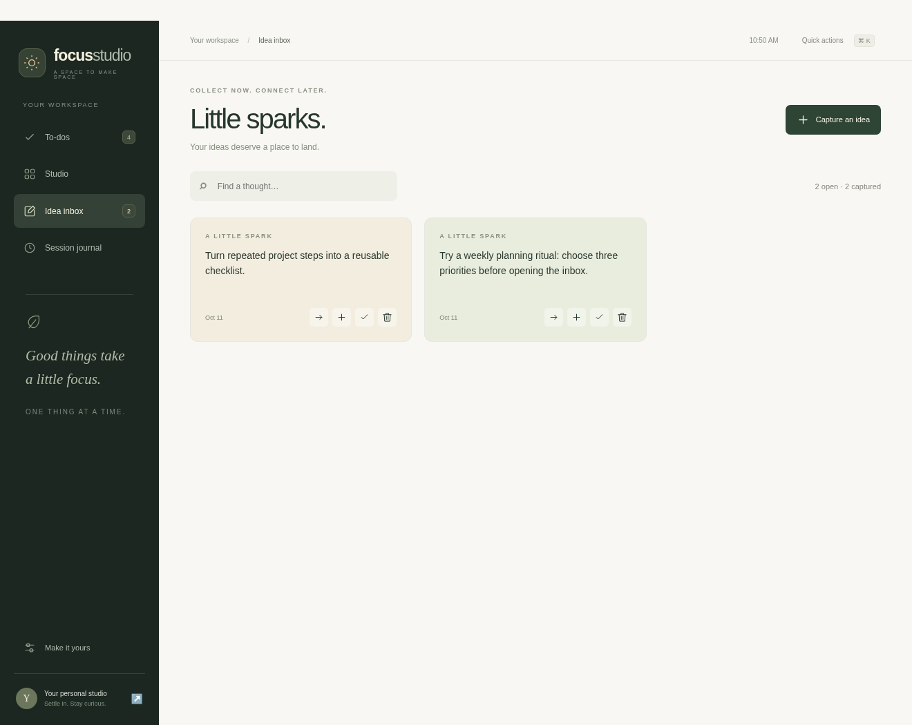
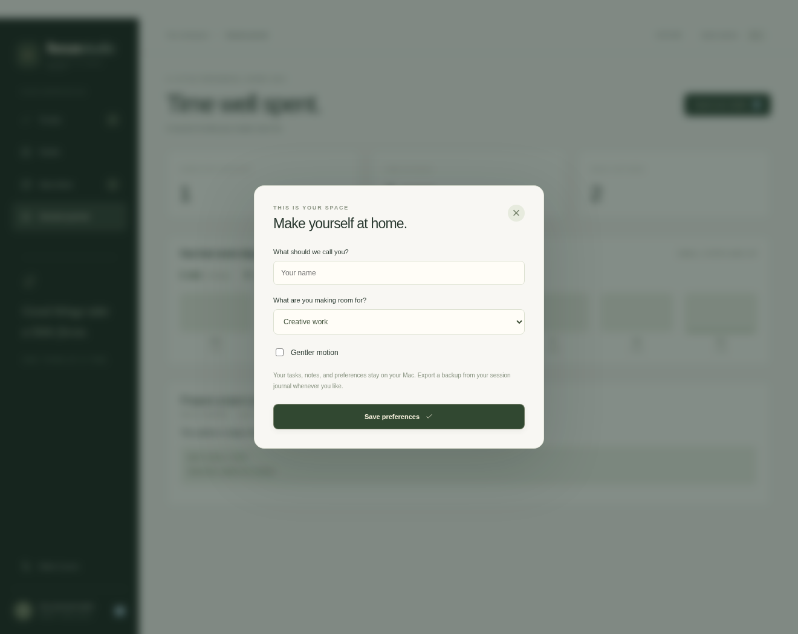

# Focus Studio preview

Version 0.3.0 · Apple silicon · macOS 13+


The logo above is the app's existing icon, also packaged as [app.icns](../desktop/assets/app.icns). These screenshots are actual Electron UI captures on Linux with an isolated sample workspace. They show the desktop interface, not Finder, Gatekeeper, macOS menus, Dock, or notifications. Sample work is never added to your own studio.

Follow the [illustrated how-to guide](user-guide.md) for the daily workflow or the [Mac installation guide](macos-app.md) to set up the app.

## Plan today

The summary brings unfinished work, estimated effort, and overdue deadlines into one view. Tasks carry projects, priorities, and subtasks.


## Make tasks concrete

Keep planned dates separate from deadlines and break down larger work in the task editor.



## Focus and immerse

Start a session from a task, leave a next step, and expand the landscape when you want more room to focus.


## Reflect and review

Record what changed, keep a next step, and optionally complete the linked task. The captured session is a short demonstration; its saved duration comes from the actual elapsed timer.





## Keep work beside you

The floating window shares the main app's Today tasks, focus session, and seven-day totals. Pin it beside your work and capture or complete tasks without moving through the main views.





The separate native WidgetKit companion is included as source and an Xcode project. Native widget captures are pending a Mac build; the floating window above is an Electron feature. See [widget installation](widgets.md).

## Catch ideas and personalize

Give passing thoughts a place to land. Turn them into tasks when they become actionable. Preferences offer a name, work mode, and gentler motion.





## Refresh the captures

From the repository root, after installing Node 24+, run:

```sh
cd desktop
npm ci
npm run capture:previews
```

The [capture script](../desktop/scripts/capture-previews.mjs) launches the real development app in a temporary profile, adds sample work through the interface, walks through focus/reflection/ideas, and saves ten PNGs to docs/screenshots/. It closes the app and removes its sample profile afterward. It leaves your production studio untouched.

A graphical session is required. On Linux, run with a virtual display such as `DISPLAY=:99 npm run capture:previews` after starting Xvfb. The Linux automation uses Electron's `--no-sandbox` launch flag; the shipped app's isolated renderer settings are unchanged. Native macOS behavior still needs a Mac check.

Review each capture for readable text and accidental personal content before committing. Keep filenames stable so README and guide embeds continue working. The older studio-desktop.png and studio-mobile.png files document the earlier browser prototype; macos-tasks-preview.png is the earlier desktop test capture.
